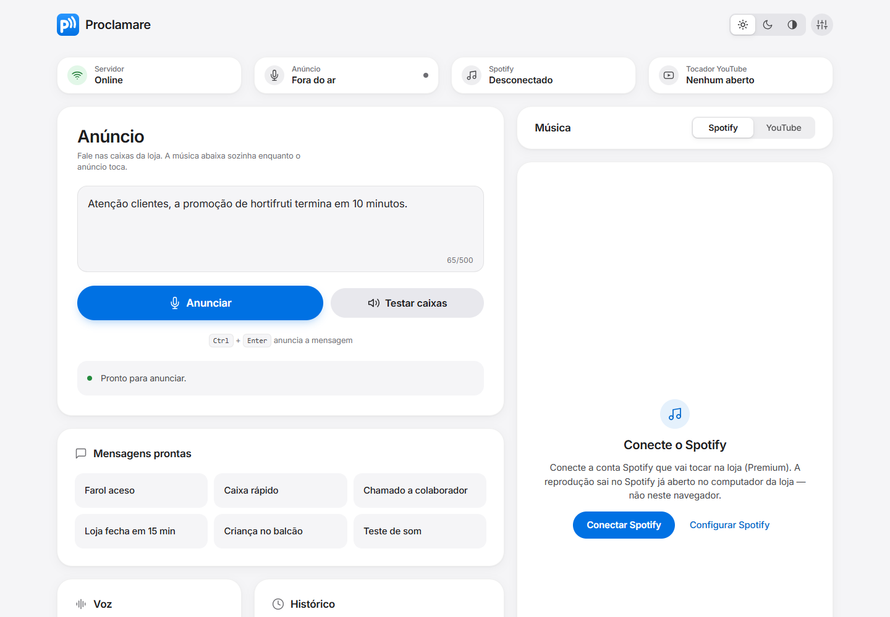
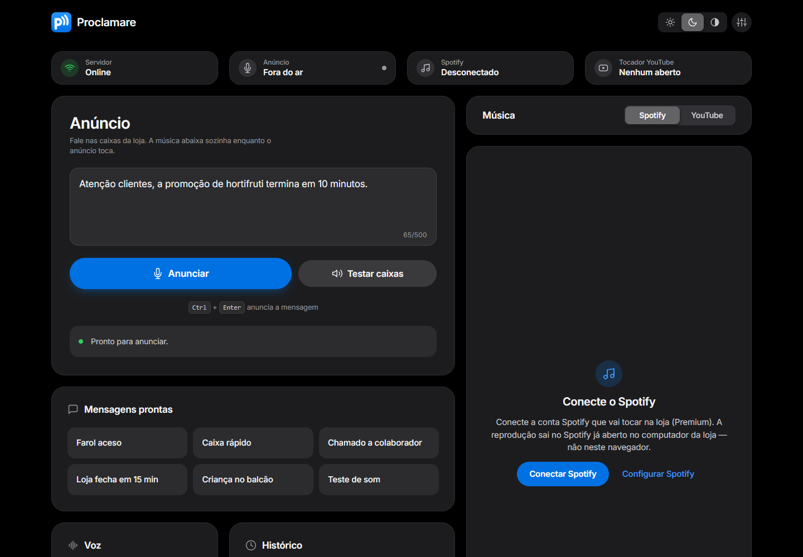
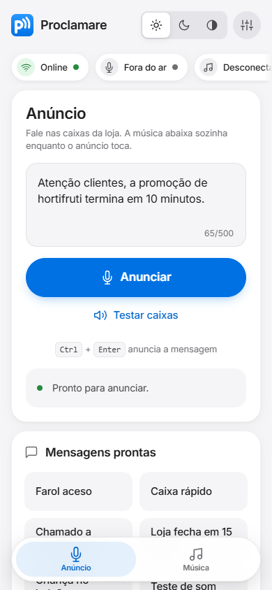
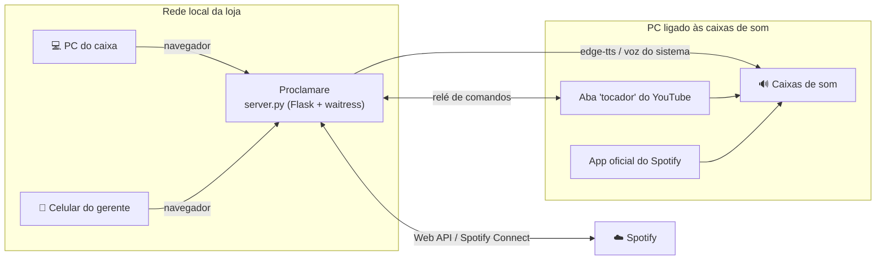

<div align="center">


# Proclamare

**A central de som da sua loja: anúncios de voz e música ambiente, controlados de qualquer tela da rede.**


</div>

---

*Proclamare*, do latim, significa **anunciar em público** — o que o arauto fazia com o clarim.
Este projeto faz o mesmo nas caixas de som de uma loja ou supermercado: você digita a mensagem
em qualquer computador ou celular da rede, e ela sai em voz natural nas caixas da loja. A música
de fundo **abaixa sozinha** durante o anúncio e volta ao volume normal no final.

<p align="center">
  
  
</p>

## ✨ O que ele faz

### 📢 Anúncios de voz
- **Texto vira fala nas caixas da loja** com vozes neurais em português (Francisca ou Antônio, via Microsoft Edge TTS).
- **Funciona sem internet:** se a conexão cair, usa a voz do próprio sistema operacional (modo *Auto*), ou você escolhe *Online* / *Offline* manualmente.
- **Velocidade ajustável** da fala (−50% a +50%).
- **Aviso sonoro antes do anúncio**, como nos aeroportos e supermercados: *Microfone* (o padrão, com sineta no início e no fim), *Aeroporto*, *Supermercado* (início e fim), *Ding-dong (2 vezes)* ou nenhum, com botão **Ouvir** para escutar nas caixas. O som é criado pelo próprio Proclamare (sem direitos autorais).
- **Voz da loja:** motor, voz, velocidade e aviso valem para todos os aparelhos (escolheu no celular, muda no computador da loja também).
- **Mensagens prontas** com um clique — e **editáveis**: troque, apague, reordene e crie as da sua loja (até 24; vêm 6 de exemplo, como farol aceso, caixa rápido e loja fechando, e dá para restaurá-las).
- **Histórico** dos anúncios do dia, com um toque para repetir.
- Atalho **Ctrl + Enter** para anunciar e **botão de teste** para conferir as caixas.
- Proteção contra atropelo: um segundo anúncio não toca por cima do que já está no ar.

### 🎵 Música ambiente
- **Spotify (via Spotify Connect):** busca músicas e playlists, toca, pausa, avança, volta e ajusta volume do app oficial do Spotify no PC da loja — com capa do álbum e barra de progresso. Quando algo impede (conta sem Premium, fora de *User Management*, Spotify fechado no PC, autorização de ~6 meses vencida), a lâmpada fica âmbar e o painel diz o motivo e o que fazer.
- **YouTube:** toca vídeos ou playlists por link (começando na música do link, até em links de "Mix"), com **fila visível** — adicionar, reordenar, remover e ver as próximas da playlist; uma aba fica como "tocador" no PC da loja e os demais aparelhos viram controle remoto, com comandos chegando quase na hora.
- **Minhas músicas:** baixou a música, ela aparece no painel — é só soltar os arquivos (MP3, M4A, AAC, OGG, OPUS, WAV, FLAC) na pasta *Músicas do Proclamare* do PC da loja, ou **enviar pelo celular**, direto da galeria. Busca, pastas, **Tocar pasta** com *Embaralhar* e a mesma fila do YouTube; toca na aba "Tocador da loja".
- **Listas e programação de horários:** crie listas de músicas no painel e marque a hora para tocar um áudio da pasta (ex.: a Ave Maria às 18:00), uma lista (ex.: "Manhã calma" de segunda a sexta às 8:00) ou um anúncio de texto — todo dia, em dias da semana ou numa data. No horário a música que estiver tocando (aba Tocador e Spotify) é **pausada e volta de onde parou**; áudio (MP3, OGG, WAV ou FLAC, até 10 min) e anúncio tocam mesmo com o navegador fechado; a lista precisa da aba "Tocador da loja" aberta. No painel: seção **Listas** em *Minhas músicas* (Nova lista, Tocar, Embaralhar, Editar, "＋ Lista" em cada música) e bloco **Programação** (aba **Horários** no celular), que substitui o Agendador do Windows. Passo a passo no `docs/GUIA.md` (seções 4b e 4c).
- **Abaixa a música automaticamente** durante cada anúncio (Spotify, YouTube e Minhas músicas) e restaura o volume no final.

### 🖥️ Controle de qualquer lugar da rede
- O som sempre sai no computador ligado ao amplificador; **qualquer PC, tablet ou celular** da rede local abre o painel no navegador, sem instalar nada.
- **Outros aparelhos pedem um PIN** (6 a 8 números, definido no PC da loja em Configurações → Acesso pela rede, ou por `python server.py --definir-pin`). O PC da loja nunca pede PIN; sem PIN definido, o acesso pela rede fica desligado.
- Indicadores ao vivo: servidor online, anúncio no ar, Spotify conectado, tocador do YouTube ativo.
- **Som da loja:** reconhece tudo o que está ligado ao PC e garante que o anúncio saiu no lugar certo — você testa a saída com um bipe, e o painel avisa se o padrão do Windows mudou, se a saída está mutada ou em 0%, ou se outro app a tomou (seção "Som da loja" do [guia](docs/GUIA.md)).

### 🎨 Interface
- Layout **Bento Grid** limpo, inspirado no estilo Apple.
- **Tema claro, escuro ou automático** (segue o sistema), salvo por aparelho.
- **Responsivo** do celular ao monitor largo, com navegação por abas no celular, transições suaves e respeito a "reduzir movimento".
- Acessível: navegação por teclado, foco visível, contraste AA e avisos lidos por leitores de tela.

<p align="center">
  
</p>

## 🧠 Como funciona



## 🚀 Começando

**Caminho fácil (Windows):** baixe ou clone o projeto → dê duplo clique em **Instalar Proclamare.bat** → depois é só dar duplo clique no ícone **Proclamare** na Área de Trabalho. Para desligar: botão **⏻** no topo do painel (só no computador da loja) ou Menu Iniciar → *Desligar Proclamare*. Detalhes na seção "Instalar e ligar com duplo clique" do [guia](docs/GUIA.md).

**Não precisa instalar o Python antes.** O instalador usa o Python 3.10 a 3.13 que já estiver no computador; se não houver, baixa sozinho uma cópia oficial do Python 3.12 só para o Proclamare (sem administrador, sem mexer no PATH nem no registro, com impressão digital e assinatura conferidas). Detalhes em "Python: o instalador resolve sozinho" no [guia](docs/GUIA.md).

**Atualizar:** copie o **Atualizar Proclamare.bat** para a pasta do Proclamare (sem internet, copie junto o ZIP da versão nova, sem descompactar) e dê duplo clique. Ele confere o pacote antes de mexer em qualquer coisa, desliga o Proclamare, guarda uma cópia do programa atual em `backups\`, instala, confere o código e liga de novo. Se algo falhar, volta sozinho para a versão anterior. Contas, listas, horários, mensagens e configuração nunca são tocados. Sem ZIP na pasta, ele baixa a versão nova do GitHub. Não há assinatura digital: a confiança vem do endereço fixo do GitHub por HTTPS (ou do ZIP que você trouxe) e da conferência do pacote. Detalhes em "Atualizar o Proclamare" no [guia](docs/GUIA.md).

**Pelo terminal (qualquer sistema):**

```bash
git clone https://github.com/arturgabriels779-alt/proclamare.git
cd proclamare
python -m venv venv
venv\Scripts\activate          # Linux/Mac: source venv/bin/activate
pip install --only-binary :all: -r requirements.txt   # Windows: pip install --require-hashes --only-binary :all: --no-deps -r requirements.lock
python server.py
```

Abra **http://127.0.0.1:8502** no PC da loja. Nos outros aparelhos, use **http://IP-DO-PC-DA-LOJA:8502**.

> O guia completo — conectar o Spotify, configurar o YouTube, IP fixo, firewall, iniciar junto com o Windows/Linux e solução de problemas — está em **[docs/GUIA.md](docs/GUIA.md)**.

## 👥 Primeiro acesso (contas e perfis)

1. No **PC da loja**, abra o painel e clique em **Criar conta de administrador** (aviso no topo, ou *Configurações → Acesso pela rede*). Essa conta pode tudo; a partir dela o PIN deixa de valer.
2. Em *Configurações → Contas*, crie uma conta para cada pessoa: **funcionário** (só anuncia), **gerente** (anuncia, música, horários, contas de funcionários) ou **administrador** (tudo, inclusive som, segurança e Spotify). Contas não são apagadas, só desativadas.
3. Cada um entra com o próprio usuário e senha (o PC da loja sai sozinho após 5 min sem clique/tecla; o Tocador e os horários seguem tocando). O *Histórico* mostra quem anunciou o quê, por 90 dias.
4. Esqueceu a senha do último administrador? Com o Proclamare desligado: `python server.py --redefinir-senha <usuario>`.

Detalhes, tabela de perfis e privacidade: seção 2d do [guia](docs/GUIA.md).

## ⚙️ Configuração

| Variável | Padrão | Para quê |
|---|---|---|
| `PROCLAMARE_HOST` | `0.0.0.0` | Endereço de escuta (`127.0.0.1` = só este computador) |
| `PROCLAMARE_PORT` | `8502` | Porta do servidor |
| `PROCLAMARE_LOG_LEVEL` | `INFO` | Nível de detalhe do log |
| `PROCLAMARE_LOG_FILE` | *(vazio = console)* | Arquivo de log (rotativo: 5 MB, 3 antigos) |
| `PROCLAMARE_PID_FILE` | *(vazio)* | Arquivo JSON com o PID do servidor (usado pelo lançador para desligar o processo certo) |
| `PROCLAMARE_CONFIAR_LOOPBACK` | `auto` | `auto` = o PC da loja é local enquanto não houver encaminhamento de rede para a porta; `1` = sempre; `0` = nenhuma conexão é "local": todos precisam de PIN (use com proxy/túnel no PC da loja) |
| `PROCLAMARE_SPOTIFY_REDIRECT` | `http://127.0.0.1:8502/spotify/callback` | Redirect URI cadastrado no painel do Spotify |
| `PROCLAMARE_MUSICAS_DIR` | *Músicas do Windows*`\Músicas do Proclamare` | Pasta das Minhas músicas |
| `PROCLAMARE_MUSICAS_ENVIO` | `1` | `0` desliga o envio de músicas pelo painel. Ligado, só o PC da loja e aparelhos com PIN podem mandar corpo grande (até 100 MB por envio); o resto da API aceita no máximo 64 KB |
| `PROCLAMARE_ALLOWED_HOSTS` | *(vazio)* | Nomes de host extras aceitos, separados por vírgula |

## 🛡️ Segurança e desempenho

- **Credenciais só no servidor:** o Client Secret do Spotify fica no `config.json` local (ignorado pelo Git) e nunca é enviado ao navegador; só pode ser alterado a partir do próprio PC da loja.
- **Contas e perfis (v2.8):** depois do primeiro administrador, todos entram com usuário e senha (PBKDF2) e cada rota exige a capacidade do perfil. O texto abaixo (PIN) vale enquanto não houver contas.
- **Acesso pela rede com PIN:** aparelhos remotos só controlam o painel após digitar o PIN (hash PBKDF2, sessão por cookie assinado de 14 dias, bloqueio por tentativas). O PC da loja (loopback) não pede PIN; sem PIN o acesso remoto fica desligado. O PIN protege contra curiosos, mas a rede usa `http`: mantenha o Wi-Fi de clientes separado.
- **Proteções web:** Content-Security-Policy rígida, checagem de `Origin`/`Content-Type` contra CSRF, lista de hosts contra DNS rebinding, `state` de uso único no login OAuth e validação de todas as entradas.
- **Leve para ficar ligado o dia todo:** servidor waitress, conexões reaproveitadas com a API do Spotify, cache compartilhado entre os aparelhos, todo o áudio numa única thread dedicada e *long-polling* em vez de consultas a cada segundo.

## 🔒 Privacidade (LGPD)

- **O texto dos anúncios vai à Microsoft** no modo online (voz neural, via Edge TTS, fora do Brasil e sem contrato próprio). No modo **Offline** (voz do Windows) nada sai do computador. Evite nomes completos, CPF e placas nos anúncios.
- **No PC da loja** ficam o `config.json` (hash do PIN, segredo do Spotify), a programação (com o texto dos anúncios agendados) e `logs/` com o **IP dos aparelhos**. A trilha `logs/auditoria.log` tem rotação diária e guarda 90 dias, e **nunca** o texto dos anúncios.
- **Histórico de anúncios (v2.8, com contas):** `anuncios.jsonl` guarda nome, função e **texto** de cada anúncio por **90 dias** e apaga sozinho; ninguém edita nem apaga.
- **No celular de cada pessoa** fica o histórico dos últimos 20 anúncios (use *Limpar*).
- Sem telemetria: nada é enviado aos autores. Detalhes e roteiro de resposta a incidente (PIN vazado, aparelho perdido, segredo do Spotify vazado; há botão **Desconectar Spotify** e uma área **Segurança** no painel do PC da loja): seções 9 e 10 do [guia](docs/GUIA.md). Falhas de segurança: veja [SECURITY.md](SECURITY.md).

## 🧪 Como rodar os testes

```bash
pip install --require-hashes --only-binary :all: --no-deps -r requirements.lock   # Windows, Python 3.10-3.13
python -m unittest discover -s tests -t .
```

Os testes não tocam som nem usam a pasta de músicas real. O GitHub roda os mesmos testes e uma auditoria
das dependências (`pip-audit`) a cada mudança (`.github/workflows/testes.yml`).

## 🧰 Tecnologias

**Backend:** Python · Flask · waitress · requests · edge-tts · pyttsx3 · pygame
**Frontend:** HTML, CSS e JavaScript puros (sem framework e sem build) · YouTube IFrame API
**Integrações:** Spotify Web API (Spotify Connect)

## ⚠️ Direitos autorais da música

Contas pessoais de Spotify e YouTube são licenciadas para uso pessoal. Tocar música para clientes
em um estabelecimento comercial normalmente exige licenciamento à parte — no Brasil, pelo **ECAD**.
Os próprios termos do Spotify também não permitem usar a conta pessoal/Premium para tocar na loja: para uso comercial prefira **Minhas músicas** com arquivos licenciados ou um serviço de música ambiente licenciado (seção 5 do guia). Os termos mudam: confira os vigentes em spotify.com/legal e consulte antes de usar em operação contínua.

## 📄 Licença

Copyright (C) 2026 Artur Gabriel.

O Proclamare é software livre, distribuído sob a **GNU Affero General Public License v3.0**
(AGPL-3.0); o texto completo está em [`LICENSE`](LICENSE). Na prática:

- qualquer pessoa ou loja pode **usar de graça**, estudar e modificar o programa;
- quem **distribuir** o Proclamare, modificado ou não, ou **oferecê-lo como serviço pela rede**,
  precisa entregar o código-fonte completo sob a mesma licença;
- o programa vem **sem garantia** de qualquer tipo (seções 15 e 16 da licença).

A fonte Inter (`static/fonts/`) tem licença própria, a SIL Open Font License (`static/fonts/OFL.txt`).
