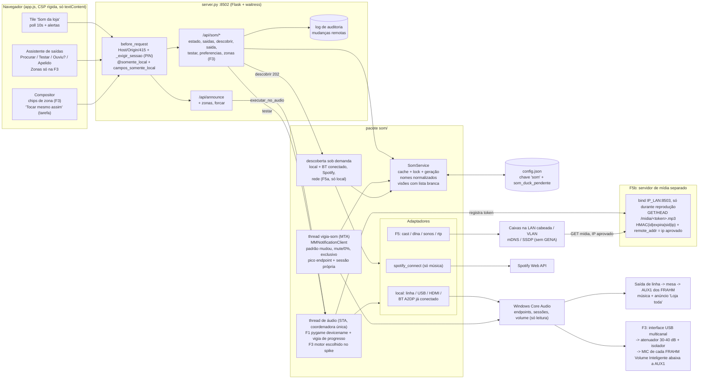

# Plano: Saídas de som e descoberta automática

> Documento de arquitetura (contrato v2.2 → v2.3). Desenhado pelo `arquiteto` a partir de 5 frentes de pesquisa (com testes reais), revisado por um crítico de viabilidade e pelo `red-team-seguranca`. Status: **aprovado pelo Artur em 2026-10-15; implementação a partir da F0.**

## Decisões tomadas

| Tema | Decisão |
|---|---|
| Tipos de equipamento | Todos: saídas do PC, Bluetooth, caixas de rede e Spotify Connect (em fases) |
| Zonas | Importantes. Agora 1 zona ("Loja toda" pelo cabo atual); depois do diagnóstico F0, placa USB multicanal + atenuadores no MIC dos FRAHM (F3) |
| Celular (com PIN) | Testar, renomear e trocar saída por cabo/USB (com teste confirmado). Bluetooth, rede, HDMI e microfone só no PC da loja |
| Tarefa agendada tocando | Avisar e permitir "Tocar mesmo assim" |
| Produto | Open source, sem fins comerciais — facilitar o uso por redes de lojas. Caixas de rede (F5) entram depois da F3, pensando em outras lojas |
| Demais | Seguem as recomendações abaixo (fallback só para saída aprovada; FRAHM em LINE; ducking do Spotify.exe opt-in; sem microfone por enquanto; sem relé de gongo por enquanto) |

## Visão

SUBSISTEMA "SAÍDAS DE SOM" DO PROCLAMARE (contrato v2.2 -> v2.3), REVISÃO 2 (já com as críticas de viabilidade e de segurança)

O QUE DÁ PARA PROMETER
O Proclamare encontra sozinho tudo o que está ligado ao PC ou à rede: as saídas do PC, o Bluetooth já pareado e conectado, os aparelhos Spotify Connect e as caixas de rede (F5). Ele sugere qual saída é "o som da loja", testa com bipe e pergunta "ouviu?", guarda cada saída aprovada e, na F3, organiza as saídas em ZONAS. Também AVISA quando o resto do sistema sai do lugar: o padrão do Windows mudou, a saída está mutada ou em 0%, o Spotify está em modo exclusivo, o anúncio não gerou sinal, a loja está em silêncio.
A mesa analógica e os FRAHM ligados por cabo não têm canal de dados, e nenhum software os "vê". Para eles, o diferencial é o assistente guiado junto com o monitor.
Como descrever o recurso (README/divulgação do projeto open source): "reconhece tudo o que está ligado ao PC ou à rede e garante que o anúncio saiu na área certa". Não usar "reconhece qualquer som".

O QUE MUDOU NESTA REVISÃO (correções obrigatórias)
1. [bloqueante, viabilidade] Zonas pela AUX2 DESCARTADAS. Pelo manual do Slim 2500/3800, cada canal tem uma chave que escolhe UMA fonte (AUX1/USB, AUX2 ou MIC). Mandar o anúncio pela AUX2 cortaria a música que vem da mesa. Novo caminho das zonas: o anúncio entra no MIC (P10) do FRAHM da área, com atenuador de linha para microfone de 30-40 dB e isolador de terra. A música continua na AUX1 pela mesa, e o "Volume Inteligente" do FRAHM abaixa a música da área sozinho, no hardware. Por isso, em anúncio de uma zona só, abaixar_musica_geral passa a ser false por padrão. A F0 confirma a chave seletora e se o MIC entra em CH1, em CH2 ou nos dois.
2. [alto] A F4 (Bluetooth avançado) saiu do roadmap. O BT dos FRAHM fica atrás da AUX1. Ligado em BT, o canal perde a música da mesa, a senha 3333 é pública e não há como trocar LINE/BT por software. O Bluetooth continua coberto (decisão 1 do Artur): um aparelho pareado e conectado aparece como saída comum desde a F1. O pareamento guiado e o watchdog de reconexão só voltam se surgir uma loja com caixa BT "pura", e mesmo assim só com as condições de segurança listadas em fora_de_escopo.
3. [alto] Motor das zonas (F3): a F3 começa com um spike de medição (F3.0) entre (a) sounddevice só com WASAPI, auto_convert e reinit do PortAudio sem nenhum stream aberto, disparado pela geração do vigia, e (b) um subprocesso pygame por zona. Motivo: o PortAudio tira uma foto dos dispositivos no import e não vê hot-plug. Texto corrigido sobre COM: o conflito de apartamento é POR THREAD, não pela ordem dos imports. O que importa é em qual thread acontecem o Pa_Initialize e o primeiro uso de COM.
4. [alto] O caminho central da F1 passa a ter teste AUDÍVEL no aceite, pedido explicitamente ao Artur, com a loja fechada e no PC do rack. O vigia de progresso tem teto abaixo de TIMEOUT_REPRODUCAO_S (80 s) < TIMEOUT_AUDIO_S (90 s, server.py:1146). Se o executor de áudio ainda assim for substituído (server.py:1181), o mixer é marcado como "contaminado" e ninguém mexe no pygame até reiniciar.
5. [alto] Alertas que dão valor já nesta loja, levados para a F1: padrao_windows_mudou, saida_mutada, volume_zero e saida_em_uso_exclusivo. O SDL é forçado a usar WASAPI compartilhado e nunca o modo exclusivo.
6. [médio] O "sinal detectado" agora é medido pela SESSÃO do próprio processo do Proclamare no endpoint (IAudioSessionManager2 ativado no dispositivo), e não pelo pico do endpoint, que a música contamina. O pico do endpoint serve só para "loja em silêncio".
7. [médio] Placas USB iguais não têm identidade estável. Recomendo UMA interface multicanal (um relógio só: zona = canal, sem eco entre áreas). Com várias placas: portas etiquetadas e novo "bipe -> ouviu? -> qual área" para CADA placa sempre que algum endpoint USB mudar.
8. [médio] Tarefa agendada tocando: o padrão passa a ser "avisar e permitir forçar" (409 com pode_forcar, e o cliente reenvia forcar: true). A detecção exige pico > 0 por 3 s, e não só sessão ativa.
9. [médio] pycaw==20260927 fixado (é a única versão testada e já passou a quarentena de 14 dias). Lockfile com hashes, pip install --require-hashes e requirements separados por fase (núcleo, zonas, rede).
10. [médio] Bluetooth e streams da F3: abrir uma vez e manter aberto tocando silêncio. Nada de abrir um stream por anúncio.
11. [médio] F1 enxuta: o /api/som/zonas e o passo "Zonas" do assistente passam para a F3. Estimativa realista de 8-12 dias com o fluxo do projeto.
12. [segurança, bloqueante para a F5b] A rota /midia sai do app Flask. Ela passa a ser servida por um SEGUNDO servidor WSGI mínimo, ligado SÓ ao IP da LAN (nunca 0.0.0.0) e vivo só durante uma reprodução de rede. O token fica preso a sid + IP aprovado, e o remote_addr é conferido.
13. [segurança, alto] Caixa de rede: UUID + IP não autenticam. Passam a valer: LAN cabeada ou VLAN da loja como requisito, nunca a Wi-Fi de clientes; MAC do vizinho (GetIpNetTable2) registrado na aprovação e suspensão se ele mudar; resultado de rede mostrado como "enviado", não "confirmado"; zona com SÓ saída de rede não recebe anúncio crítico.
14. [segurança, médio] Regra "somente local" centralizada (decorador @somente_local + função campos_somente_local chamada DEPOIS de validar um esquema estrito em todos os níveis). Toda ação de aprovação que envolva sid de rede ou Bluetooth, HDMI, fone ou se_indisponivel=padrao_windows é só local. Limite de testes por IP e global. Trocar a saída de anúncio pelo celular exige teste + "ouviu: sim" da mesma sessão nos 5 minutos anteriores, além de log de auditoria e alerta no tile.
15. [segurança, médio] Nomes vindos de terceiros são normalizados no servidor (NFKC, sem Cc/Cf nem bidi, até 64 caracteres). O final do MAC/UUID aparece num elemento separado. O TTS de teste NUNCA fala um nome do sistema.
16. [segurança, baixo] As respostas são montadas com lista branca de campos, com teste que falha se aparecer endpoint_id, mac, host, uuid, client_secret ou acesso_.

PRINCÍPIOS DO DESENHO (mantidos)
1. Nunca mexer no Windows: nada de SetDefaultDevice nem de rota por app. As tarefas agendadas (WMP/VLC), o Spotify e o Chrome continuam como estão. O Proclamare escolhe só a PRÓPRIA saída e só LÊ o resto (estado, volume, mute, sessões).
2. Descobrir é automático e só lê. Conectar ou tocar exige que um humano tenha aprovado aquela saída uma vez.
3. Chave estável = referência do sistema (ID do endpoint; MAC no BT; UUID + IP + MAC do vizinho na rede). O cliente nunca envia ID, IP, MAC ou URL: o servidor gera um sid opaco, e só vale sid que já exista no cache ou no config. O sid é um identificador, não um segredo.
4. Adaptadores por tipo, com interface pequena: descobrir(), resolver(ref), tocar(buffer, handle, canais), capacidades.
5. Uma thread de áudio continua COORDENANDO toda a reprodução. Se a F3 escolher subprocessos por zona, eles são extensão dessa thread, e o CLAUDE.md é atualizado na mesma tarefa. O vigia e a descoberta só leem e só escrevem no cache, com lock. Os handlers do waitress nunca chamam COM.
6. Sem a chave "som" no config = comportamento atual (devicename=None), sem regressão.

ESTRATÉGIA TÉCNICA (com trade-offs)
- F1, reprodução: pygame.mixer.init(devicename=...) com SDL_AUDIODRIVER=wasapi forçado em os.environ ANTES de importar o pygame. Ganha: nenhuma dependência nova de áudio. Perde: um dispositivo por vez, o que basta enquanto a loja tiver uma zona só.
- F1, voz offline: pyttsx3.save_to_file -> WAV -> o mesmo motor, com um só caminho de reprodução, ducking e vigia. Perde: muda o caminho que hoje funciona, por isso há teste audível e limpeza de *.wav.
- F1, inventário: pycaw (Core Audio) + lista do SDL (driver wasapi) sem abrir stream. Leitura de IAudioEndpointVolume (mute e volume) e da sessão do próprio PID via IAudioSessionManager2 ativado no endpoint. O GetAllSessions do pycaw olha só o padrão e não serve aqui.
- F1, classificação da falha ao abrir: se o SDL falhar, uma sonda de diagnóstico (IAudioClient::Initialize em modo compartilhado, liberada na hora, rodando na thread vigia) separa AUDCLNT_E_DEVICE_IN_USE (modo exclusivo de outro app) de "dispositivo ausente". NÃO VERIFICADO: provar na F0.
- Tempo real: IMMNotificationClient na thread vigia-som (MTA). Os callbacks só incrementam a geração, e a thread reenumera. OnDefaultDeviceChanged alimenta o alerta padrao_windows_mudou.
- F3, zonas: spike F3.0 com critérios objetivos, ver fases. Preferência inicial: (a) sounddevice se a loja usar UMA interface multicanal (o mapeamento de canais é nativo e o pygame não mapeia mais de 2 canais com facilidade); (b) subprocesso pygame por zona se forem várias placas estéreo (hot-plug do próprio SDL e quedas isoladas).
- Spotify Connect: é destino de MÚSICA, nunca de anúncio.
- Rede (F5): descoberta presa à interface da LAN escolhida no PC local, só sob demanda. Mídia servida por um servidor separado com bind no IP da LAN.

ESTRUTURA (código na raiz do repositório)
server.py                  -> rotas /api/som/* (o contrato fica num lugar só); integração em _anunciar/_garantir_mixer/musica_abaixada; decorador @somente_local; máscara de /midia no log da linha 215 (defesa extra)
som/__init__.py            -> fachada SomService: cache + lock + geração; iniciar()/parar() no main() e no atexit
som/modelo.py              -> dataclasses Saida, Zona, Alvo, Alerta; esquema estrito; geração do sid; normalizar_nome(); visao_publica() com lista branca de campos; read-modify-write da chave "som" sob _config_lock
som/local.py               -> adaptador local: pycaw + SDL, classificação, pontuação, volume e mute (só leitura), sonda de modo exclusivo
som/vigia.py               -> thread vigia-som: MMNotificationClient, pico do endpoint e da sessão própria, alertas
som/motor.py               -> MotorAudio (F1 pygame; F3 conforme o spike), vigia de progresso, bipe de teste, estado "contaminado"
som/abaixar.py             -> ducking em camadas (Spotify API, relé do YouTube, F2 sessões locais com lista branca fixa)
som/rede/{descoberta,cast,dlna,sonos,rtp}.py e som/rede/midia_wsgi.py -> F5, imports tardios dentro de try/except ImportError
static/app.js (seção 17c), static/index.html, static/styles.css (designer-ui)
docs/GUIA.md e CLAUDE.md   -> "Contrato v2.3" na mesma tarefa; requisito de rede cabeada e fora da Wi-Fi de clientes; efeito de PROCLAMARE_CONFIAR_LOOPBACK=0
requirements.txt (núcleo + F1/F2), requirements-zonas.txt (F3), requirements-rede.txt (F5), cada um com .lock e hashes
tools/instalar.ps1         -> --require-hashes; pip-audit em modo aviso; regras de firewall só com consentimento e escopo mínimo

"RECONHECER SOM" NO SENTIDO DE OUVIR: VALE como complemento.
(a) Medidor de pico, sem microfone e sem gravar. Na F1 entram o pico da sessão própria (o anúncio saiu?) e o do endpoint (a loja está em silêncio?). Na F2 entra o pico por app (Spotify, WMP, VLC, navegador), que mostra "WMP da tarefa agendada tocando agora".
(b) Microfone (F6): ruído ambiente e confirmação acústica do bipe. Exige microfone USB na área, opt-in e cuidados de LGPD. Fica por último.

## Diagrama



## Tipos de saída

| Tipo | Fase | Viabilidade | Descoberta | Conectar | Anúncio | Abaixar música |
|---|---|---|---|---|---|---|
| Saída local: placa interna / saída de linha (o cabo que hoje vai para a mesa) | F1 (MVP) | alta | Automática e só de leitura. pycaw EnumAudioEndpoints traz ID, FriendlyName normalizado, estado, EnumeratorName, FormFactor e o pino 'lineout'. O resultado é cruzado com a lista do SDL (driver wasapi forçado). Hot-plug pelo MMNotificationClient. Também lê, sem alterar, o volume e o mute do endpoint (IAudioEndpointVolume). Pontuação de sugestão: Spotify.exe/wmplayer/vlc com pico > 0 (+50), linha ou alto-falante interno plugado (+30), padrão do Windows (+15), HDMI (-40), fone ou headset (-40). | Não há conexão: basta abrir o dispositivo. Só usa a saída depois que ela for aprovada com bipe + 'ouviu?'. | F1: pygame.mixer.init(devicename=nome resolvido a partir do ID na hora), sempre em WASAPI compartilhado e nunca exclusivo. Trocar = quit+init na thread de áudio ANTES de abaixar a música. Vigia de progresso: teto = min(duração + 3 s, 80 s), ou get_pos parado por 2 s, encerra com erro, sempre antes do TIMEOUT_AUDIO_S de 90 s. Se o SDL falhar ao abrir, a sonda separa 'em uso exclusivo' de 'ausente'. F3: conforme o spike do motor. | O mesmo de hoje (Spotify Web API + relé do YouTube). F2: camada opcional por sessão local (ISimpleAudioVolume) só do Spotify.exe, de lista branca fixa no servidor, com o volume anterior persistido em som_duck_pendente. |
| Saída local USB (placa USB barata ou interface multicanal 5.1/7.1) | F1 (como saída única); F3 (como zonas) | alta | Automática: EnumeratorName USB. Placas idênticas não têm número de série, e o endpoint_id/container_id muda com a porta. O nome_sistema '2- USB Audio Device' não serve de identidade. A interface multicanal é UM endpoint com N canais. | Plugar na USB. O vigia percebe e oferece 'Saída nova encontrada: testar?'. Uma saída aprovada que volta com o MESMO endpoint_id é reativada sozinha. Se QUALQUER endpoint USB aprovado mudar (ID novo, porta trocada, driver reinstalado), TODAS as placas USB aprovadas ficam suspensas até um novo 'bipe -> ouviu? -> qual área' para cada uma. | F1: devicename (uma saída por vez). F3 recomendado: UMA interface multicanal configurada pelo técnico (7.1). Cada par ou canal vai, por atenuador, ao MIC de um FRAHM. Um único relógio garante zonas sem deriva nem eco e zona = mapeamento de canais. F3 alternativa: várias placas estéreo, com as portas etiquetadas. | Com o anúncio entrando no MIC e o Volume Inteligente ligado, o FRAHM abaixa a música da área sozinho. Por isso abaixar_musica_geral = false por padrão nessas zonas. Sem Volume Inteligente, valem as camadas de software. |
| Saída local HDMI/DisplayPort (monitor LG) | F1 (listar, penalizar e alertar troca de padrão) | alta | Automática: FormFactor 9/HDMI, rótulo 'Monitor (HDMI)'. Se o Windows mudar o padrão para o HDMI (reativação pelo driver de vídeo), o vigia emite padrao_windows_mudou: 'a música e as tarefas agendadas foram para Monitor (HDMI)'. | Nunca é sugerida. Aprovar para anúncios só no PC local, com o aviso 'normalmente não chega às caixas'. | Possível via devicename, mas sem utilidade na loja atual. Útil numa loja com TV ligada ao PC. | Igual ao local. |
| Bluetooth A2DP (caixas BT; os FRAHM só em contingência) | F1 (pareado e conectado aparece sozinho). Pareamento guiado e reconexão estão FORA do roadmap. | media | F1, sem custo: um aparelho pareado E conectado aparece como endpoint BTHENUM na mesma lista. O final do MAC fica num elemento separado do nome, porque os 4 FRAHM se chamam 'FRAHM APP'. BTHHFENUM (viva-voz) fica oculto. Sem varredura de próximos: ela saiu do roadmap junto com a F4. | O pareamento é feito pelo usuário nas Configurações do Windows. O Proclamare não pareia, não reconecta e não envia DISCONNECT. Aprovar uma saída BT para anúncios é só no PC local. | Igual ao local. O stream fica aberto tocando silêncio enquanto a saída estiver em uso, para evitar o AVDTP suspend, que leva de 0,5 s a alguns segundos para retomar. Prefixar silêncio só com o tempo medido no aparelho real. Se a caixa cair no meio da fala, o vigia de progresso encerra e há fallback. ATENÇÃO, FRAHM: em BT o canal perde a AUX1 (mesa), então um anúncio por BT deixa a área sem música; a senha 3333 é pública. | Igual ao local. Nos FRAHM, nenhum ducking compensa a perda da entrada LINE em modo BT. |
| Spotify Connect (app desktop do PC, Echo, TV, receivers da conta) | F2 | alta | Automática pela rota existente /api/spotify/devices. Aparece no grupo 'Música do Spotify', com is_restricted visível. | Transferência (PUT /me/player, já existe) só por clique. Nunca transfere sozinho. | Não toca anúncio (a Web API não reproduz um mp3 arbitrário). Um alvo Spotify Connect numa zona devolve 400. | PUT /me/player/volume (já existe). Aparelho is_restricted: aviso 'não dá para abaixar'. |
| Google Cast (Chromecast, caixas com Chromecast built-in, grupos) | F5 (5a descoberta; 5b reprodução) | media | F5a: zeroconf só em modo browse (nunca register_service), preso a rede.interface_ip escolhido no PC local. Só tipos de áudio. O host vindo do mDNS passa pelo filtro de faixa privada e mesma sub-rede. Teto de 256 respostas. Nada fica persistido sem aprovação. | Allowlist local-only por UUID + IP + MAC do vizinho (GetIpNetTable2). Se o MAC do IP aprovado mudar, se o UUID mudar de IP, se aparecer nome duplicado ou UUID novo com nome conhecido, a aprovação é suspensa. Avaliar o DeviceAuth da biblioteca. Se não houver, a limitação fica escrita no produto. | F5b: gerar o mp3 -> registrar token preso a sid + IP -> o servidor de mídia separado sobe no IP da LAN -> play_media -> esperar IDLE com teto -> revogar o token, apagar o arquivo e derrubar o servidor de mídia. O resultado é 'enviado', não 'confirmado'. | Música em outra caixa: set_volume nela. Na MESMA caixa: o anúncio substitui a sessão e a retomada pelo Spotify é pouco confiável (o painel avisa). |
| DLNA / UPnP MediaRenderer | F5 | media | F5a: SSDP M-SEARCH com IP_MULTICAST_IF na interface escolhida. LOCATION só com IP LITERAL igual ao do remetente, privado, na mesma sub-rede, nunca loopback ou link-local, porta entre 1 e 65535 e diferente da do Proclamare. allow_redirects=False, timeout de 2 s, no máximo 64 KB, defusedxml (o XML é buscado e parseado por conta própria se o async-upnp-client não usar defusedxml). No máximo 1 KB por resposta SSDP e 256 respostas. Só renderers com AVTransport. | Allowlist por UDN + IP + MAC do vizinho, igual ao Cast. | F5b: SetAVTransportURI(url do servidor de mídia) + Play, com o estado lido por POLLING de GetTransportInfo (sem assinatura GENA, para não abrir listener) e teto de duração. | SetVolume na caixa da música, se houver RenderingControl. Senão, parar e retomar. |
| Sonos | F5 (só com aparelho real) | media | F5a: zeroconf _sonos._tcp em modo browse ou SSDP, com os mesmos filtros. | Allowlist por RINCON + IP + MAC do vizinho. | F5c: sonos-websocket play_clip (S2): sobrepõe o anúncio à música e restaura sozinho. Fallback com soco: Snapshot -> play_uri -> restore. | Nativo no play_clip; no fallback, ramp_to_volume. |
| Caixa IP de sonorização (multicast RTP: Algo, Axis, Yealink, Intelbras) | F5 (opcional, só se houver caixa IP) | media | Não existe descoberta padrão: o cadastro é manual e só no PC local. Só grupos 239.0.0.0/8, portas acima de 1024, TTL 1. | Não há conexão: envio UDP ao grupo cadastrado. SIP fora de escopo. | F5d: decodificar -> G.711 µ-law 8 kHz -> RTP de 20 ms (audioop-lts ou numpy). O protocolo não tem autenticação: o GUIA recomenda VLAN dedicada e listas de origem nas caixas. | Pelas camadas existentes, antes de enviar. |
| AirPlay / AirPlay 2 | Pós-F5, só com demanda real | baixa | F5a: zeroconf _raop/_airplay em modo browse, só para listar. | Não implementado: aparece como 'não suportado ainda'. | Adiado. O pyatv RAOP só funciona com pareamento legado, e AirPlay 2 com HAP fica fora de escopo. | Não se aplica. |
| Amazon Echo / Alexa | Não implementar (coberto por BT e Connect) | inviavel | Só aparece via Spotify Connect ou como BT pareado e conectado. | Sem API local oficial. | Inviável por protocolo próprio. Via BT funciona como qualquer caixa BT. | Via Spotify Connect, só para música. |
| Equipamento analógico do rack (mesa e FRAHM por cabo) | F1 (guia e checklist no assistente); F3 (cabeamento das zonas) | inviavel | Impossível por software (não há canal de dados). No lugar disso, um 'perfil do rack' informado pelo usuário em cada alvo: entrada_frahm = aux1_mesa \| mic \| aux2, ducking_hardware true/false. O medidor de pico prova que o PC entregou o sinal, não que ele chegou às caixas. | Por cabo, pelo técnico, com a loja fechada. Pelo manual do Slim 2500/3800: cada canal tem chave seletora (AUX1/USB \| AUX2 \| MIC); a AUX1 é ligada por dentro ao módulo BT/USB/FM (deve ficar em LINE); só o MIC soma com AUX1/AUX2. A sensibilidade do MIC é 14 mVRMS: linha de 0,3-1 V exige atenuador de 30-40 dB ou DI passiva, mais isolador de terra. | 'Loja toda' (F1): saída de linha -> mesa -> AUX1 de todos os FRAHM, como hoje. Zonas (F3): canal da interface multicanal -> atenuador -> MIC do FRAHM da área. A F0 confirma se o MIC entra em CH1, em CH2 ou nos dois, e isso define se a granularidade é por canal ou por amplificador. | No hardware: o Volume Inteligente abaixa AUX1/AUX2 quando há voz no MIC. Opcional e futuro: relé USB no External GONGO (P10) para o ding-dong e a prioridade do próprio FRAHM (decisão do Artur). |

## Fases

| Fase | Esforço | Entrega |
|---|---|---|
| F0 - Diagnóstico no PC da loja e teste audível (sem código de produto) | P-M (1 dia com o Artur presente + meio dia para consolidar) | Com o Artur presente e a loja FECHADA. (1) Rodar o listar.py (só leitura) no PC do rack: lista real de saídas (linha, HDMI LG, USB, BT), volume e mute, o padrão atual e se a placa Realtek permite separar as saídas frontal e traseira. (2) TESTE AUDÍVEL pedido explicitamente ao Artur (script de spike no scratchpad, fora do produto): tocar na saída de linha por devicename com SDL_AUDIODRIVER=wasapi; tocar um WAV gerado pelo pyttsx3; desplugar o cabo no meio da fala e medir o tempo até o erro; ligar o modo exclusivo do Spotify e confirmar a falha e o HRESULT que a sonda devolve; confirmar que os eventos do MMNotificationClient chegam (plugar USB, trocar o padrão). (3) No FRAHM: fotografar modelo e etiqueta; ver a posição da chave seletora de cada canal; se o MIC entra em CH1, CH2 ou nos dois; se o Volume Inteligente existe e funciona; se dá para trocar a senha BT ou desligar a visibilidade. (4) Mesa: os canais ESTAC./ELEVADOR 2... são entradas ou saídas/zonas? (5) Tarefas agendadas: qual executável (wmplayer, vlc ou o mp3 direto), qual usuário e se a sessão fica ativa depois do fim da faixa. (6) Perfil de rede (Domain/Private) e regras de firewall do pythonw do .venv, para saber se o acesso por PIN da v2.2 está bloqueado em silêncio. (7) A rede da loja: há VLAN ou LAN cabeada separada da Wi-Fi de clientes? Os resultados definem o cabeamento da F3 e confirmam as premissas da F1. |
| F1 - 'Som da loja' enxuto: saída fixada, testada e vigiada | G (8-12 dias com dev, revisor + red-team, correções e QA) | Pacote som/ com: SomService; adaptador local (pycaw==20260927 + SDL wasapi); normalizar_nome; visao_publica com lista branca; classificação e pontuação; thread vigia-som (MMNotificationClient); alertas saida_ausente, saida_mutada, volume_zero, saida_em_uso_exclusivo (sonda), padrao_windows_mudou, anuncio_sem_sinal (sessão própria via IAudioSessionManager2 no endpoint), silencio (pico do endpoint), saida_mudou, usb_mudou_retestar e saida_alterada_remoto. MotorAudio pygame com devicename, vigia de progresso (teto min(duração + 3 s, 80 s)), estado motor_contaminado e stream mantido aberto. Voz offline via save_to_file WAV pelo mesmo motor (limpeza com *.wav). Fallback outra_aprovada_ou_falhar. Rotas /api/som/estado, /saidas, /descobrir {local, spotify}, /saida, /testar e /preferencias, com @somente_local, campos_somente_local, testes_recentes (412), limite de taxa por IP e global e log de auditoria. Tile + assistente passos 1-3 e 5. Contrato v2.3 nos dois lados + GUIA + CLAUDE.md. requirements.txt e .lock com hashes; instalar.ps1 com --require-hashes, pip-audit em modo aviso e mínimo Python 3.10; regra TCP 8502 opcional com consentimento (Private+Domain, LocalSubnet, caminho absoluto do pythonw do .venv), só se a F0 mostrar bloqueio. Testes automatizados com motor falso. ACEITE: repetir com o build final o teste audível da F0 (pedido explícito ao Artur, loja fechada), incluindo a restauração da música depois da queda. |
| F2 - Monitor por app, ducking local e Spotify Connect na mesma tela | M (5-7 dias) | Pico por sessão (Spotify, WMP, VLC, navegador) a ~4 Hz com o painel aberto e 1 Hz para alertas. 'tocando_agora' no estado. Detecção da tarefa agendada tocando (pico > 0 por 3 s) com 409 tarefa_agendada_tocando, pode_forcar e forcar. Camada opcional de ducking do Spotify.exe (lista fixa no servidor, volume_pct 5..100, som_duck_pendente persistido antes e restaurado no main() com validação). Destinos Spotify Connect no grupo 'Música do Spotify'. Teste de restauração após kill do processo (sem som real). |
| F3.0 - Spike do motor de zonas (decide sounddevice ou subprocesso pygame) | P-M (2-3 dias) | Protótipo das duas opções no ambiente isolado. Medido no PC do rack com a interface escolhida e com teste audível pedido ao Artur: (1) recuperação depois de replugar a USB e reconectar sem reiniciar; (2) diferença de início entre zonas; (3) isolamento de falha (uma zona cai e as outras continuam); (4) mapeamento de canais 1..8; (5) convivência com o COM STA do pyttsx3 na thread de áudio (Pa_Initialize em qual thread); (6) sample rate: WasapiSettings(auto_convert=True) com a placa a 48 kHz e o TTS a 24 kHz; (7) CPU e memória. Regras para a opção (a): só host API WASAPI; reinit do PortAudio só na thread de áudio, sem nenhum stream aberto, disparado pela geração do vigia; casamento pelo nome WASAPI completo cruzado com o pycaw. Regras para a opção (b): subprocesso [sys.executable, '-I', módulo absoluto], sem shell, CREATE_NO_WINDOW, stdin DEVNULL, protocolo por pipe com comandos de lista fechada, coordenado pela thread de áudio. Saída: decisão documentada + atualização da regra de áudio no CLAUDE.md, se for a opção (b). |
| F3 - Zonas reais (anúncio pelo MIC dos FRAHM) | G (8-12 dias de software + meio dia de técnico + interface multicanal ~R$ 150-400 ou placas ~R$ 40-80 cada, mais atenuadores e isoladores ~R$ 40-100 por zona) | Motor escolhido no F3.0, com streams abertos uma vez e mantidos (silêncio entre anúncios). POST /api/som/zonas completo; 'zonas' no /api/announce com resultado parcial; chips no compositor; passo 4 do assistente com o perfil do rack (entrada_frahm, ducking_hardware); abaixar_musica_geral com padrão derivado do Volume Inteligente; todas_via mesa/zonas; suspensão e novo teste de todas as USB quando qualquer uma mudar. Cabeamento (técnico, loja fechada): a música continua PC -> mesa -> AUX1 dos FRAHM. Para os anúncios, UMA interface USB multicanal (recomendada) ou placas estéreo com portas etiquetadas -> atenuador de linha para mic de 30-40 dB (ou DI passiva) + isolador de terra -> MIC (P10) do FRAHM de cada área, com o Volume Inteligente ligado. A granularidade (por canal ou por amplificador) é a que a F0 confirmar. Requirements-zonas.txt com lock e hashes. |
| F4 - Bluetooth avançado: CANCELADA (coberto pela F1) | 0 (meia hora de documentação dentro da F1) | Nenhum código novo. O Bluetooth pareado e conectado já é uma saída comum desde a F1, com aprovação só no PC local. O GUIA ganha uma seção: 'Caixa BT: pareie no Windows; FRAHM: deixe em LINE (o modo BT desliga a música da mesa e a senha 3333 é pública)'. O pareamento guiado e o watchdog só voltam com uma loja que tenha caixa BT 'pura' e com as condições de segurança de fora_de_escopo. |
| F5a - Descoberta de rede (só leitura) | M (4-5 dias) | zeroconf em modo browse e SSDP presos a rede.interface_ip (escolhida no PC local, com aviso de Wi-Fi ou sub-rede maior que /23). Filtros de LOCATION (IP literal = remetente, privado, mesma sub-rede, sem redirect, sem loopback ou link-local, porta diferente da do Proclamare), 2 s / 64 KB / defusedxml, até 256 respostas e 1 KB por SSDP. Só tipos de áudio. Nada persistido sem aprovação. O inventário não aprovado some ao fechar o diálogo e nunca vai para remotos. Aprovação com MAC do vizinho (GetIpNetTable2). requirements-rede.txt com hashes, instalado só se a opção for ligada. Regras de firewall: TCP e UDP separadas, Profile Private+Domain (nunca Public), RemoteAddress LocalSubnet, nome próprio e remoção no -Desinstalar. GUIA: requisito de LAN cabeada ou VLAN, fora da Wi-Fi de clientes. |
| F5b-d - Reprodução em rede (Cast/DLNA, Sonos, RTP) | GG (12-18 dias + auditoria do red-team) | 5b: servidor de mídia separado (bind no IP da LAN, vivo só durante a reprodução, token HMAC preso a sid + IP, remote_addr conferido, limites de requisições e conexões, revogação, máscara de log e os testes obrigatórios do contrato) + Cast e DLNA (polling, sem GENA; resultado 'enviado'; campo critico e 422 para zona só de rede). 5c: Sonos play_clip. 5d: RTP G.711 multicast (239/8, porta acima de 1024, TTL 1, cadastro local). Python 3.11 se o pychromecast exigir. Avaliar o DeviceAuth do Cast. |
| F6 - Microfone (opcional, opt-in) | M (4-5 dias + microfone USB) | Microfone USB numa área. O microfone abre SÓ durante a janela do teste do bipe (FFT restrita à faixa do bipe da zona, com frequência própria por zona) para confirmar o 'ouviu?' automaticamente. Opcionalmente, nível ambiente a 1 Hz (média) para sugerir o volume do anúncio, com histerese e faixa limitada. As amostras são processadas no callback e descartadas: nada em disco, nada em log, nenhuma rota devolve espectro ou amostras. Remotos veem no máximo o nível agregado por minuto. Liga e desliga só no PC local, desligado por padrão, com indicador visível. Registro de finalidade (RIPD simples) e placa de aviso na área, se a loja adotar. |

## Política de conexão automática

AUTOMÁTICO, SEM PERGUNTAR (só leitura ou retomada do que já foi aprovado)
- Enumerar as saídas locais e o BT pareado e conectado na inicialização e a cada hot-plug.
- Ler o volume, o mute e o estado dos endpoints e o padrão do Windows. Só lê, nunca altera.
- Listar os aparelhos Spotify Connect da conta logada.
- Monitor de pico do endpoint e da sessão própria; na F2, por app. Sem microfone.
- Sugerir a 'saída da loja' por pontuação. É só uma sugestão.
- Reusar uma saída JÁ aprovada que volta com a MESMA referência (mesmo endpoint_id; no BT, mesmo MAC; na rede, mesmo UUID + IP + MAC do vizinho).
- Fallback para OUTRA saída aprovada da mesma zona.
- Restaurar o som_duck_pendente ao iniciar, só da lista branca e só com volume de 0.0 a 1.0.

SUGERE E PEDE CONFIRMAÇÃO (um clique, local ou remoto com PIN)
- Tocar o bipe de teste (sempre por clique, com aviso no horário comercial e limite por IP e global).
- Aprovar e usar para anúncios uma saída local por cabo ou USB. No remoto, exige teste + 'ouviu: sim' da mesma sessão nos 5 minutos anteriores, e gera log de auditoria e alerta no tile.
- Nomear saídas. Montar zonas com alvos por cabo ou USB (F3).
- Adotar uma saída 'que parece ser a mesma' (cabo ou USB).
- Transferir a música para outro aparelho Spotify Connect.
- Tocar por cima de uma tarefa agendada ('Tocar mesmo assim').

SÓ NO PC LOCAL E COM CONFIRMAÇÃO EXPLÍCITA
- Aprovar, usar ou adotar QUALQUER saída Bluetooth, de rede, HDMI ou fone, e colocá-las em zonas.
- se_indisponivel = padrao_windows.
- Ligar a descoberta de rede e escolher a interface, com aviso vermelho se for Wi-Fi ou sub-rede maior que /23.
- Aprovar cada aparelho de rede (UUID + IP + MAC do vizinho). Mudança de IP ou de MAC, nome duplicado ou UUID novo com nome conhecido suspende a aprovação.
- Abaixar o Spotify.exe pelo mixer do Windows (a lista de processos é fixa no servidor).
- Ligar o microfone (F6).
- Cadastrar um grupo RTP (só 239.0.0.0/8, porta acima de 1024).
- As regras de firewall são criadas pelo instalar.ps1, com consentimento, nunca pelo app.

NUNCA
- Conectar, parear ou tocar em aparelho que não foi aprovado.
- Parear ou reconectar Bluetooth por software, ou enviar DISCONNECT.
- Trocar a saída padrão do Windows, o volume ou o mute de endpoints, ou gravar rota por app.
- Abrir dispositivo em modo exclusivo.
- Tocar som de teste automaticamente ou em testes automatizados (os testes usam motor falso). O som real só acontece no teste audível pedido explicitamente ao Artur, com a loja fechada.
- Falar pelo TTS um nome vindo do Windows ou da rede.
- Assinar eventos GENA, anunciar o Proclamare em mDNS ou seguir redirect de LOCATION.
- Mandar anúncio crítico para uma zona que só tem saída de rede.
- Gravar ou transmitir áudio do microfone, ou expor espectro e amostras por rota.
- Desativar tarefas do Agendador.
- Cair em HDMI ou fone: com outra_aprovada_ou_falhar (padrão), o padrão do Windows só é usado se ele próprio estiver aprovado. Senão, 503 e alerta vermelho.

## Experiência de uso

TILE 'SOM DA LOJA' (5o item da .status-row; estilo Bento claro/escuro; visual a cargo do designer-ui)
- Valor: '<apelido> · tocando' (verde), '· em silêncio' (cinza), 'Cabo desconectado' ou 'Saída mutada no Windows' ou 'Volume em 0% no Windows' ou 'Em uso exclusivo por outro app' (vermelho), 'Padrão do Windows' (âmbar, quando não há configuração, com o link 'Configurar').
- Selo âmbar persistente quando o padrão do Windows mudou: 'A música e as tarefas agendadas foram para Monitor (HDMI). Os anúncios continuam no Cabo para a mesa.' Botão 'Como corrigir' com o passo a passo do Windows. O Proclamare não troca o padrão.
- 'Proclamare precisa ser reiniciado' (vermelho) se o motor ficar contaminado.
- F3: 'Estac. ok · Elevador ausente' (âmbar se parcial). Um clique abre o assistente.
- Escondido se disponivel = false. Alertas viram toast discreto, uma vez cada. Toda mudança remota de destino fica no tile até alguém marcar 'visto'.

ASSISTENTE 'MINHAS SAÍDAS DE SOM' (<section class="sheet"> nas Configurações, entre Spotify e #net-section)
Passo 1, Procurar: ao abrir, mostra o cache. 'Procurar de novo' chama {local, spotify}. 'Procurar na rede' (F5) só aparece no PC local, com o aviso 'Vai aparecer também aparelho de vizinhos: só aprove os seus'. Não existe botão de Bluetooth próximo: o texto orienta 'Pareie a caixa nas Configurações do Windows e ela aparece aqui sozinha'.
Passo 2, Lista agrupada: 'Neste PC', 'Bluetooth', 'Música do Spotify', 'Na rede' (só F5 e só local). Cada linha tem:
- o apelido ou o nome sugerido em negrito;
- o nome do sistema pequeno e cinza;
- o final do MAC ou do UUID num elemento separado e destacado, nunca colado ao nome;
- os selos 'Sugerida', 'Padrão do Windows', 'Tocando agora: Spotify' (com mini VU, F2), 'Mutada', 'Desconectada', 'Nome com caracteres incomuns' e 'Não suportada: motivo';
- os botões [Testar] e [Usar]. Para remotos, o [Usar] some em BT, rede, HDMI e fone, com a nota 'aprovar no PC do Proclamare'.
Nomes sugeridos (editáveis): linha -> 'Cabo para a mesa (Realtek)'; HDMI -> 'Monitor (HDMI) - normalmente não vai para as caixas'; BT -> 'Caixa Bluetooth' + sufixo separado; USB -> 'Placa USB 1'.
Passo 3, Testar:
- Antes de tocar, com a loja em horário comercial: 'O bipe vai sair nas caixas. Continuar?'. Interruptor 'Abaixar a música durante o teste' (ligado por padrão no celular).
- Toca o bipe + 'Teste do Proclamare: <apelido ou saída N>' e pergunta 'Ouviu na loja?' [Sim] [Não] [Tocar de novo].
- Sim -> apelido + 'Usar para anúncios'. Na F3, também 'Em qual área?'.
- Não -> mostra 'O PC enviou sinal: sim/não' (sessão própria) e o checklist do rack: 'O canal do PC na mesa está aberto?', 'O FRAHM mostra LINE?', 'A chave do canal está em AUX1/USB?', 'O cabo está na saída verde/de linha?', 'A saída não está mutada no Windows?'. Depois oferece testar a próxima sugerida.
- Dica fixa: 'Dá para testar pelo celular: vá até a área, entre com o PIN e toque em Testar.'
Passo 4, Zonas (SÓ F3, quando houver 2 ou mais saídas ou canais aprovados): cartões por área com canais (L/R ou 1..8); campo 'Esta saída entra no FRAHM pelo: Mesa (AUX1) / MIC / AUX2' e 'O FRAHM abaixa a música sozinho (Volume Inteligente)?'. O padrão de 'abaixar a música da loja toda' segue essa resposta. Opção 'Anúncio para Todas sai por: Mesa (recomendado com placas separadas) / Todas as zonas (interface multicanal)'. Aviso de eco com placas diferentes na mesma área.
Passo 5, Preferências (recolhido): o que fazer se a saída sumir; alerta de silêncio; abaixar Spotify.exe direto no Windows (só local, F2); tarefa agendada tocando: avisar ou ignorar.

COMPOSITOR DE ANÚNCIO
- F3: chips de zona [Todas] [Estacionamento] [Elevador] (só com 2 ou mais zonas). A loja de hoje não vê nada novo.
- 409 tarefa_agendada_tocando: diálogo 'Uma tarefa agendada está tocando (Windows Media Player). [Esperar] [Tocar mesmo assim]'. O segundo botão reenvia com forcar: true.
- Resultado: 'Saiu em: Estacionamento, Elevador', 'Parcial: Elevador sem saída' ou, na F5, 'Enviado para Caixa Nest (sem confirmação)'.

REGRAS DE IMPLEMENTAÇÃO DA UI
- Sem on*="" e sem style inline (CSP): addEventListener e classes em styles.css.
- Listas com createElement/textContent, NUNCA innerHTML.
- scheduler.add('som-estado', pollSom, 10000) dentro de startApp() (depois da porta do PIN). O poll de /saidas a 1 s só roda com enabled: () => dialog.open.
- A flag local ou remoto vem do /api/auth/status existente. O servidor recusa de qualquer forma (403), e a UI só esconde.
- Tratar 412 teste_necessario: 'Teste esta saída e confirme que ouviu antes de usá-la'.

## Modelo de dados

```text
config.json ganha a chave de topo "som" e a chave auxiliar "som_duck_pendente", ambas gravadas SEMPRE em read-modify-write sob _config_lock. Sem "som" = comportamento atual. As rotas devolvem SÓ visões montadas por som/modelo.py:visao_publica(), com lista branca explícita de campos. Nunca se faz **saida, dict(saida) nem se devolve "ref". Há um teste que procura endpoint_id, mac, host, uuid, client_secret e acesso_ no JSON de todas as /api/som/*.

VALIDAÇÃO: esquema estrito em TODOS os níveis. Chave desconhecida em qualquer profundidade, tipo errado ou valor fora da faixa = 400. Strings humanas passam por validar_str (até 40 caracteres, sem controle). Nomes de terceiros passam por normalizar_nome: NFKC, remoção de Cc/Cf (U+200B-200F, U+202A-202E, U+2066-2069, U+FEFF), corte em 64 caracteres e flag nome_incomum quando sobra algo fora do ASCII imprimível.

"som": {
  "versao": 1,
  "saidas": {                                   // SÓ saídas aprovadas ou nomeadas; no máx. 64
    "loc_3f2a9c1e7b04": {                       // sid = prefixo do tipo + sha256(ref canônica)[:12]; identificador, não segredo
      "tipo": "local",                          // lista branca: local | bluetooth | spotify_connect | cast | dlna | sonos | rtp
      "subtipo": "linha",                       // placa_interna | linha | usb | usb_multicanal | hdmi | fone | bt_a2dp | grupo_cast ...
      "ref": {                                  // interno; nunca sai do servidor
        "endpoint_id": "{0.0.0.00000000}.{11111111-...}",
        "nome_sistema": "Alto-falantes (Realtek(R) Audio)",
        "container_id": "{43fa1e8d-...}"
      },
      "apelido": "Cabo para a mesa",            // definido por humano; é o ÚNICO texto que o TTS de teste fala
      "aprovada": true,
      "confirmada_em": "2026-10-20T09:12:00-03:00",
      "aprovada_por": "local" | "remoto",       // remoto só se houver teste + ouviu na mesma sessão nos últimos 5 min
      "canais": 2,
      "rack": { "entrada_frahm": "aux1_mesa" | "mic" | "aux2" | null, "ducking_hardware": false },  // perfil informado pelo usuário
      "visto_em": "..."
    },
    "usb_8a21c4d0e911": { "tipo": "local", "subtipo": "usb_multicanal", "canais": 8, "...": "..." },  // F3
    "bt_9c0d4a5e2f11": { "tipo": "bluetooth", "subtipo": "bt_a2dp",
      "ref": { "endpoint_id": "...", "mac": "AA:BB:CC:DD:EE:3C", "container_id": "..." },
      "apelido": "Caixa BT do depósito", "aprovada": true, "aprovada_por": "local" },
    "cast_51e0aa9b3c72": { "tipo": "cast",      // F5
      "ref": { "uuid": "a1b2...", "host": "192.168.0.50", "porta": 8009, "mac_vizinho": "..." },
      "aprovada": true, "aprovada_por": "local", "aprovada_ip": "192.168.0.50", "aprovada_mac": "..." }
  },
  "saida_anuncio": "loc_3f2a9c1e7b04",          // F1/F2: saída única = zona implícita "loja"
  "padrao_referencia": "loc_3f2a9c1e7b04",      // padrão do Windows no momento da aprovação; base do alerta padrao_windows_mudou
  "zonas": [                                    // F3; no máx. 16 zonas, 8 alvos por zona
    { "id": "estacionamento", "nome": "Estacionamento",
      "alvos": [ { "sid": "usb_8a21c4d0e911", "canais": [1, 2] } ],
      "abaixar_musica_geral": false }           // padrão false quando TODOS os alvos têm rack.ducking_hardware = true; senão true
  ],
  "todas_via": "mesa" | "zonas",               // F3: 'Todas' pela saída da mesa (placas separadas, evita eco) ou por todos os canais (interface multicanal única)
  "zona_padrao": "todas",
  "se_indisponivel": "outra_aprovada_ou_falhar",  // outra_aprovada_ou_falhar | padrao_windows (só local) | falhar
  "abaixar": {
    "spotify_api": true, "youtube": true,
    "sessoes_locais": { "ativo": false, "volume_pct": 12 }   // F2; processos = constante fixa no servidor ("Spotify.exe"), NÃO vem do cliente; volume_pct inteiro 5..100
  },
  "teste": { "abaixar_musica_remoto": true, "abaixar_musica_local": false },
  "monitor": { "ativo": true, "alerta_silencio_min": 10, "horario": { "inicio": "07:00", "fim": "22:00" },
               "tarefas_agendadas": "avisar" },  // avisar (409 com pode_forcar) | ignorar
  "rede": { "descoberta": false, "interface_ip": null, "aceito_risco_wifi": false },  // F5; só local
  "microfone": { "ativo": false, "sid_entrada": null }      // F6; só local; nunca grava
}

"som_duck_pendente": {                          // F2: escrito ANTES de abaixar, apagado ao restaurar
  "criado_em": "...", "sessoes": [ { "processo": "Spotify.exe", "volume_anterior": 1.0 } ]
}  // no main(): restaurar SÓ processos da lista branca e volume 0.0..1.0; qualquer outra entrada é ignorada e logada

FICA SÓ EM MEMÓRIA (cache do SomService, nunca persistido):
- Saídas descobertas e não aprovadas, principalmente as de rede. Remotos nunca veem o inventário de rede não aprovado.
- Estado ao vivo: presente/ausente, volume e mute do endpoint, pico do endpoint e da sessão própria, alertas, varredura, geração, motor_contaminado.
- testes_recentes: {(id_sessao, sid): (monotonic, ouviu)} com TTL de 5 min, para autorizar troca remota da saída de anúncio.
- Contadores de taxa: testar:<ip> e testar:global (excedeu_limite, server.py:326).
- F5: segredo HMAC da mídia (secrets.token_bytes(32) por inicialização) e mapa token -> {caminho, sid, ip, expira_monotonic, reqs, conexoes}.

FORA DO CONFIG: log de auditoria (logger "proclamare.som.auditoria", no arquivo de log já existente): data, IP, sid, ação, sem segredo nem ref.

RELACIONAMENTOS: Zona 1-N Alvo; Alvo N-1 Saída (pelo sid). Uma saída pode estar em várias zonas. Spotify Connect nunca é alvo (400). Apagar uma saída remove os alvos que a referenciam; zona sem alvos = "sem_saida". F5: zona cujos alvos são SÓ de rede é marcada so_rede = true e não recebe anúncio com critico = true.

RECONCILIAÇÃO: não há adoção automática. ID sumiu e apareceu algo parecido -> alerta saida_mudou. A ref só muda com POST /api/som/saida {aceitar_nova_ref}, local-only para BT e rede. Placas USB: qualquer mudança suspende TODAS as USB aprovadas até cada uma ser testada de novo.
```

## Contrato de API (v2.3)

```text
CONTRATO v2.3. server.py, app.js, docs/GUIA.md e CLAUDE.md são atualizados na MESMA tarefa.

REGRAS QUE VALEM PARA TODAS AS ROTAS NOVAS
- Todas ficam em /api/som/*, então exigem sessão por PIN para remotos (_exigir_sessao, server.py:738). NENHUMA entra em API_PUBLICAS (server.py:595). Teste: percorrer app.url_map e falhar se alguma /api/som/* estiver em API_PUBLICAS.
- Todo POST: Content-Type: application/json (senão 415) e Origin do mesmo host (senão 403).
- Esquema estrito em todos os níveis: chave desconhecida em qualquer profundidade dá 400.
- O cliente envia só sid ou zona_id, validados por PERTENCIMENTO ao cache ou ao config.
- Erros no formato atual: {"ok": false, "erro": "..."}, e quando útil com "codigo".
- Respostas montadas por visao_publica() (lista branca).
- Nomes de terceiros: normalizados no servidor, logados com %r, renderizados com textContent.

SOMENTE LOCAL (403 {"erro": "Disponível só no PC do Proclamare"}, mesmo com PIN). Implementado em DOIS pontos únicos:
(a) decorador @somente_local nas rotas inteiras;
(b) campos_somente_local(corpo_validado, alvo), chamada DEPOIS da validação do esquema e antes de qualquer efeito.
O critério é _requisicao_local() (server.py:352). Com PROCLAMARE_CONFIAR_LOOPBACK=0, essas funções ficam indisponíveis para todos (documentado no GUIA).
Ficam só no PC local:
- Descobrir "rede"; ligar rede.descoberta e definir interface_ip.
- Aprovar, usar_para_anuncios, aceitar_nova_ref ou pôr numa zona QUALQUER sid de tipo bluetooth, cast, dlna, sonos ou rtp, ou de subtipo hdmi ou fone.
- se_indisponivel = "padrao_windows".
- abaixar.sessoes_locais.
- microfone.*
- Cadastro de rtp.

1) GET /api/som/estado   (poll de 10 s; só lê o cache)
200 {
  "versao": 1, "geracao": 42, "disponivel": true,           // false fora do Windows ou sem pycaw: o tile some
  "motor": "pygame" | "sounddevice" | "pygame_subprocesso",
  "motor_ok": true,                                         // false = mixer contaminado: "reinicie o Proclamare"
  "saida_anuncio": { "sid", "apelido", "tipo", "estado": "ok" | "ausente" | "mutada" | "volume_zero" | "em_uso_exclusivo" | "suspensa" } | null,
  "padrao_windows": { "apelido_ou_rotulo": "Monitor (HDMI)", "mudou": true },   // rótulo derivado; nunca o ID
  "zonas": [ { "id", "nome", "estado": "ok" | "parcial" | "sem_saida", "pico": 0.0-1.0 } ],   // F3
  "tocando_agora": [ { "app": "Spotify" | "Windows Media Player" | "VLC" | "Navegador" | "Outro", "saida_apelido", "pico" } ],  // F2
  "alertas": [ { "codigo", "mensagem", "desde" } ],
  "anuncio_em_andamento": false
}
Códigos de alerta F1: saida_ausente, saida_mutada, volume_zero, saida_em_uso_exclusivo ("desligue 'permitir controle exclusivo' / o modo exclusivo do Spotify"), padrao_windows_mudou ("a música e as tarefas agendadas foram para X"), anuncio_sem_sinal, silencio, saida_mudou, usb_mudou_retestar, motor_contaminado, saida_alterada_remoto ("Saída de anúncio alterada por aparelho remoto (IP x)").
F2: duck_restaurado, tarefa_agendada_tocando. F5: aparelho_rede_mudou_ip, aparelho_rede_mudou_mac.

2) GET /api/som/saidas   (poll de 1 s só com o diálogo aberto)
200 { "geracao", "varredura": { "em_andamento", "tipos", "iniciada_em", "termina_em_s" },
  "saidas": [ { "sid", "tipo", "subtipo", "nome_sistema" (normalizado), "nome_incomum": bool, "apelido" | null,
    "estado": "disponivel" | "ausente" | "desconectada" | "suspensa" | "mutada" | "volume_zero" | "em_uso_exclusivo" | "nao_suportada",
    "motivo_nao_suportada" | null, "aprovada", "confirmada_em" | null, "padrao_windows": bool,
    "sugestao": { "pontos", "motivos": [...] } | null,
    "capacidades": { "anuncio", "musica", "volume", "canais" },
    "zonas": [...], "grupo": "pc" | "bluetooth" | "musica_spotify" | "rede",
    "sufixo_id": "…:3C" | null,         // BT: final do MAC; rede: final do UUID; sempre em elemento separado na UI
    "exige_local": bool } ] }           // a UI esconde Aprovar/Usar para remotos
Remotos: o grupo "rede" lista SÓ aparelhos aprovados.

3) POST /api/som/descobrir   body {"tipos": subconjunto de ["local", "spotify", "rede"]}
202 {"ok": true, "varredura": {...}}.
400 tipo fora da lista; 403 "rede" vindo de remoto ou com rede.descoberta = false; 409 varredura em andamento; 429 mais de 6/min (por IP); 503 indisponível.
"local" inclui o BT pareado e conectado. "bluetooth_proximos" foi REMOVIDO (F4 cancelada).

4) POST /api/som/saida   (não toca som)
body {"sid", "aprovada"?: bool, "apelido"?: str(1..40), "confirmada"?: true, "esquecer"?: true, "usar_para_anuncios"?: true, "aceitar_nova_ref"?: true, "rack"?: {"entrada_frahm", "ducking_hardware"}}
Regras:
- "confirmada" só é aceito se houver um /testar daquele sid feito pela MESMA sessão nos últimos 5 min (testes_recentes).
- Remoto com "usar_para_anuncios" exige confirmada = sim da mesma sessão nos 5 min e grava aprovada_por = "remoto", log de auditoria e alerta saida_alterada_remoto.
- Os campos local-only seguem campos_somente_local().
200 {"ok": true, "saida": {...}}; 400 validação ou spotify_connect com usar_para_anuncios; 403 local-only; 404 sid desconhecido; 409 anúncio em andamento ao trocar a saída de anúncio; 412 {"codigo": "teste_necessario"} quando falta o teste recente.

5) POST /api/som/testar   body {"sid"} ou {"zona_id"} (F3), "abaixar_musica"?: bool
O padrão vem de som.teste (ligado no remoto, desligado no local). Toca um bipe de ~0,4 s + "Teste do Proclamare: <apelido humano ou 'saída N'>", NUNCA o nome do sistema. Volume de teste fixo. Usa _anuncio_lock.
200 {"ok": true, "duracao_ms": 1800, "sinal_detectado": true | false | null}   // medido pela SESSÃO do próprio PID naquele endpoint; null se não der para medir
404; 409 anúncio ou teste em andamento; 429 se passar de 3/min por IP OU de 10 a cada 10 min no total da loja (testar:<ip> + testar:global); 503 {"codigo": "ausente" | "em_uso_exclusivo" | "motor_contaminado", "erro"}.
Permitido remoto com PIN, de propósito.

6) POST /api/som/preferencias   (merge parcial com esquema estrito)
body {"se_indisponivel"?, "abaixar"?: {"spotify_api"?, "youtube"?, "sessoes_locais"?: {"ativo"?, "volume_pct"?: int 5..100}}, "teste"?: {...}, "monitor"?: {...}, "rede"?: {"descoberta"?, "interface_ip"?, "aceito_risco_wifi"?}, "microfone"?: {...}}
interface_ip tem que ser um IP de uma interface local real. Se for Wi-Fi ou a sub-rede for maior que /23, a resposta exige aceito_risco_wifi = true.
200 {"ok": true, "preferencias": {...}}; 400; 403 local-only.

7) POST /api/som/zonas   (F3; substitui a lista inteira, atômico)
body {"zonas": [{"id"?, "nome", "alvos": [{"sid", "canais"?: [int 1..8]}], "abaixar_musica_geral"?: bool}], "zona_padrao", "todas_via"?: "mesa" | "zonas"}
200; 400 (sid inexistente, canal maior que os canais da saída, mais de 16 zonas, nomes duplicados, alvo spotify_connect); 403 alvo BT, rede, HDMI ou fone vindo de remoto; 409 anúncio em andamento.
Antes da F3 a rota NÃO existe (404). Não há rota "meio funcional".

8) /api/announce (alterada)
body ganha "zonas"?: [ids] | "todas" (F3), "forcar"?: bool e, na F5, "critico"?: bool.
- Sem "zonas": zona_padrao. Sem a chave "som": comportamento atual.
200 {"ok": true, ..., "saidas_usadas": [{"zona_id", "apelido", "resultado": "tocado" | "enviado"}], "parcial": false, "aviso"?, "sinal_detectado"?: bool | null}   // "enviado" = rede (sem confirmação)
200 com "parcial": true quando algumas zonas falharam.
400 zona desconhecida.
409 anúncio em andamento.
409 {"codigo": "tarefa_agendada_tocando", "pode_forcar": true, "erro": "Uma tarefa agendada está tocando (Windows Media Player). Tocar mesmo assim?"}: detectada por pico > 0 por 3 s na sessão do wmplayer/vlc. Com "forcar": true, toca por cima. Com monitor.tarefas_agendadas = ignorar, não há verificação.
422 {"codigo": "zona_so_rede_critico"} (F5): anúncio crítico para zona sem saída por cabo.
503 nenhuma saída disponível, com "codigo".
Regras de execução:
- Resolver o ID e ABRIR o dispositivo ANTES de musica_abaixada(). Sempre restaurar no finally.
- Vigia de progresso: teto = min(duração + 3 s, TIMEOUT_REPRODUCAO_S = 80 s), menor que TIMEOUT_AUDIO_S = 90 s.
- Se _substituir_executor_audio() rodar, motor_contaminado = true: o novo executor não toca no pygame e os anúncios devolvem 503 até reiniciar.
- O software não abaixa a música da loja em zona com abaixar_musica_geral = false.

9) /api/status: SEM mudanças.

10) Bluetooth: NENHUMA rota de parear ou reconectar (F4 cancelada).

11) F5b: SERVIDOR DE MÍDIA SEPARADO (fora do app Flask, porta PROCLAMARE_MIDIA_PORT, padrão 8503)
- WSGI mínimo próprio (um waitress.create_server separado, ou wsgiref), com bind SÓ em rede.interface_ip. Nunca 0.0.0.0. Não sobe com PROCLAMARE_HOST = 127.0.0.1 nem sem saída de rede aprovada.
- Existe só enquanto houver reprodução de rede em andamento: sobe no início e desce no IDLE/STOPPED ou no teto.
- Uma única rota, GET/HEAD /midia/<token>.mp3. Não tem acesso a config, sessão nem estáticos.
- token = base64url(id_arquivo|expira_monotonic|sid_destino|ip_aprovado|HMAC-SHA256). Regex base64url estrita e no máximo 128 caracteres ANTES de decodificar. hmac.compare_digest. Exige request.remote_addr == ip_aprovado do sid.
- Até ~10 requisições e no máximo 2 conexões simultâneas por token. Range via send_file(conditional=True) ou equivalente. Arquivo em audios_temp/midia, conferido com resolve() + is_relative_to.
- Token revogado e arquivo apagado em IDLE/STOPPED ou no teto.
- Qualquer falha = 404 genérico.
- Cabeçalhos: Content-Type audio/mpeg, Cache-Control no-store, X-Content-Type-Options nosniff, sem Server.
- Log só com os 6 primeiros caracteres do id. A linha 215 do server.py também mascara /midia/*, como defesa extra.
- Testes obrigatórios: IP diferente -> 404, token expirado, adulterado ou longo demais -> 404, '../' -> 404, qualquer /api/* nesse socket -> 404.
- Exige auditoria do red-team antes de ir para produção.

STATUS USADOS: 200, 202, 400, 401, 403, 404, 409, 412, 415, 422, 429, 503.
```

## Fora de escopo

- Trocar a saída padrão do Windows (IPolicyConfig/SetDefaultDevice), ou alterar o volume ou o mute de endpoints: afeta as tarefas agendadas, o Spotify e o Chrome. O Proclamare só lê e alerta (padrao_windows_mudou, saida_mutada, volume_zero).
- Rota de áudio por app (IAudioPolicyConfigFactory) para mover o Spotify.exe ou a aba do YouTube: API não documentada. O painel só verifica onde o Spotify toca e ensina a opção manual do próprio Spotify.
- Escolher a saída da aba tocadora do YouTube (iframe de outra origem; o setSinkId não o alcança).
- Abrir dispositivo em modo exclusivo WASAPI.
- Zonas pela AUX2 do FRAHM: DESCARTADO. Pelo manual, a chave seletora do canal escolhe UMA fonte, então isso cortaria a música da mesa naquela área. Substituído pelo MIC com atenuador e Volume Inteligente.
- Bluetooth dos FRAHM como zona ou reserva: DESCARTADO. O modo BT desliga a AUX1 (música da mesa), a senha 3333 é pública, uma tentativa de conexão de celular corta o áudio por 2 s e não há troca LINE/BT por software.
- Pareamento BT guiado (DeviceInformationCustomPairing), varredura de próximos e watchdog de reconexão (KSPROPERTY_ONESHOT_RECONNECT/IKsControl): fora do roadmap até existir uma loja com caixa BT 'pura'. Se um dia voltar, condições obrigatórias: só responder a PairingKind == ProvidePin; desparear na hora se o aparelho expuser HID, HFP-AG, OBEX ou SPP; prova física (desligar e religar a caixa); MAC completo + OUI na tela; PC não detectável e sem Swift Pair; PIN fora do código (config local); resultados da varredura só em memória e nunca logados; subprocesso sem shell, com argumento resolvido no servidor.
- Descobrir ou controlar a mesa analógica e os FRAHM por cabo (não têm canal de dados). Coberto por guia, perfil do rack, teste e monitor.
- Trocar a fonte do FRAHM (LINE<->BT) por software.
- Relé USB no External GONGO do FRAHM (ding-dong e prioridade de hardware): ideia boa e barata, mas é integração de hardware nova. Fica como decisão do Artur e não entra nas fases atuais.
- Espelhar áudio sincronizado em várias caixas BT, ou sincronizar placas USB diferentes na mesma área (para isso, interface multicanal única ou 'Todas' pela mesa).
- Registrar o Proclamare como ramal SIP. Só multicast RTP, e só na F5d.
- Alexa/Echo por API própria; AirPlay 2 com HAP/HomeKit.
- Assinatura de eventos UPnP (GENA) e anúncio do Proclamare via mDNS (register_service): abririam listeners sem autenticação.
- Servir mídia pelo app Flask principal ou em 0.0.0.0: descartado em favor do servidor de mídia separado, com bind no IP da LAN.
- Caixas de rede na Wi-Fi de clientes, e atravessar VLANs ou sub-redes (reflector mDNS é responsabilidade da rede da loja).
- Agenda de anúncios dentro do Proclamare e importador do Agendador de Tarefas (SEMANADA, AVE MARIA): recomendado como PRÓXIMA meta, separada.
- Fila de anúncios: continua o 409 (um por vez).
- Fonte de música licenciada para revenda: decisão de produto.

## Riscos

- Anúncio crítico (fechamento) saindo no lugar errado (monitor LG, fone): mitigado por aprovação com bipe + 'ouviu?', HDMI e fone aprováveis só no PC local, fallback que nunca usa saída não aprovada e troca remota da saída que exige teste recente da mesma sessão, com auditoria e alerta.
- O Windows trocar o padrão para HDMI ou headset e levar o Spotify e as tarefas agendadas para lá: o Proclamare não corrige (por princípio), mas alerta na hora (padrao_windows_mudou) com o passo a passo.
- Caixa ou USB some no meio do anúncio e o SDL prende o get_busy(): vigia de progresso com teto abaixo de 80 s, finally que restaura a música e motor_contaminado se o executor for substituído com o mixer aberto, para não haver duas threads mexendo no pygame global. Comprovado pelo teste audível da F0 e do aceite da F1 (com pedido explícito ao Artur).
- Premissas da F1 ainda NÃO VERIFICADAS no PC do rack (devicename tocando, eventos do MMNotificationClient, HRESULT do modo exclusivo, WAV do pyttsx3 reamostrado): por isso a F0 tem teste audível e o aceite da F1 o repete.
- Regressão na voz offline (SAPI direto -> WAV + motor): teste audível + limpeza de *.wav.
- Medidor contaminado pela música: sinal_detectado vem da sessão do próprio PID. Se a sessão não for encontrada, a resposta é null, nunca um falso 'true'.
- Callbacks COM que bloqueiam travam o áudio do Windows: os callbacks só incrementam a geração; a thread vigia se reinicia com backoff e é desregistrada no atexit.
- Conflito de apartamento COM (é por thread): na F3, o Pa_Initialize e o primeiro uso de COM acontecem em threads decididas no spike; miniaudio continua proibido.
- PortAudio sem hot-plug (F3, opção a): reinit só sem stream aberto. Se não houver janela ociosa, a saída nova fica 'disponível após o próximo anúncio'. O spike mede isso; a opção (b) é o plano B.
- Placas USB idênticas trocando de identidade e mandando o anúncio do estacionamento para o elevador: interface multicanal recomendada; senão, portas etiquetadas e suspensão + novo teste de todas as USB a cada mudança.
- Cabeamento da F3: nível de linha no MIC (14 mV) satura ou danifica; atenuador de 30-40 dB obrigatório; o técnico confirma no manual e no aparelho; o trabalho é feito com a loja fechada, com a música mantida no caminho atual.
- Volume Inteligente pode não se comportar como o manual descreve (tempo de ataque, quanto abaixa): validar na F0. Se falhar, as zonas usam o ducking por software (abaixar_musica_geral = true).
- Tarefa agendada: falso positivo e falso negativo de detecção (player aberto depois do fim, outro usuário). O padrão 'avisar e permitir forçar' evita bloquear um anúncio urgente.
- Ducking por sessão persistido pelo Windows (Spotify a 12% depois de uma queda): som_duck_pendente gravado antes e restaurado no main(), com validação.
- Zona 'parcial' silenciosa: resposta com 'parcial', alerta no tile e log.
- Abuso remoto com PIN (bipes repetidos, troca do destino): limite por IP e global, teste recente obrigatório, campos sensíveis só no PC local e auditoria.
- Falsificação visual de nomes (homóglifos, bidi, nomes longos ou ofensivos): normalização no servidor, sufixo de ID separado, selo 'caracteres incomuns' e TTS que não fala nome de terceiros.
- Vazamento de referências internas (endpoint_id, MAC, IP) pela API: visao_publica com lista branca + teste de chaves proibidas.
- Rede (F5): caixa falsa por ARP spoofing (UUID e IP não autenticam). Mitigação: LAN cabeada ou VLAN, MAC do vizinho, resultado 'enviado', zona só de rede sem anúncio crítico e DeviceAuth avaliado. Risco residual documentado no produto.
- Rede (F5): SSRF pelo LOCATION, XML malicioso, flood de respostas e a primeira superfície sem PIN. Mitigação: filtros estritos, defusedxml, tetos, servidor de mídia separado com bind na LAN, token preso ao IP e auditoria obrigatória do red-team.
- Interfaces múltiplas (Tailscale, APIPA, BT PAN): interface escolhida explicitamente no PC local; o servidor de mídia faz bind só nela.
- Firewall no perfil Domain bloqueando em silêncio o acesso por PIN (já hoje) e a F5: verificado na F0; regras com escopo mínimo e consentimento.
- Cadeia de suprimentos (cerca de 15 pacotes, vários com um único mantenedor): lockfiles com hashes, --require-hashes, requirements por fase, quarentena de 14 dias, pip-audit em modo aviso, nomes conferidos no repositório oficial e imports tardios e tolerantes. O pip-audit ainda não rodou: CVEs das dependências não verificados.
- Bluetooth em contingência (se o Artur insistir): a senha 3333 não tem conserto por software. Risco aceito por escrito; manter o PC sempre conectado e alertar quando cair.
- Microfone (F6) e LGPD: só a janela do teste ou média de 1 Hz, nada guardado, só local, indicador visível.
- Promessa de marketing 'reconhece qualquer som' não cumprível para o analógico: alinhar a comunicação.
- Risco jurídico de produto: os termos do Spotify proíbem uso comercial em loja e o ECAD cobra execução pública. Isso condiciona o investimento em Spotify Connect e em rede para vender a outras lojas.
- Estimativas: mesmo revisadas, F1 e F3 dependem de COM e de hardware real. Dias de folga explícitos (F1 8-12, F3 2-3 + 8-12).

## Recomendações do arquiteto para as demais decisões

- **Zonas na loja atual: o que fazer com o cabeamento (hoje a mesa mistura tudo)?** — Agora A. Depois da F0 (que confirma a chave seletora, o MIC em CH1/CH2 e o Volume Inteligente), C, feito pelo técnico com a loja fechada. B só vale como experimento barato, se a F0 mostrar a saída frontal separável. D só se o orçamento impedir C. E está descartada. A antiga recomendação 'AUX2' foi retirada porque cortaria a música da área.
- **Adicionar o relé no 'External GONGO' do FRAHM (ding-dong e prioridade do próprio amplificador antes do anúncio)?** — Não por enquanto. O Volume Inteligente pelo MIC já resolve o ducking por zona. Retomar depois da F3 se o Artur quiser o ding-dong do próprio FRAHM.
- **Se a saída escolhida sumir (cabo, USB ou BT), o que o anúncio faz?** — A primeira (padrão). O padrão do Windows só é usado se também estiver aprovado, o que evita o 'fechamento' no monitor LG.
- **O que pode ser feito pelo celular (com PIN) e o que só no PC do rack?** — A segunda. Testar pelo celular, andando pela loja, é o recurso mais útil. O que pode desviar o anúncio para o lugar errado ou mexer em rádio e rede fica no PC local, e toda mudança remota fica registrada e visível.
- **Ligar o 'ducking direto no Windows' (abaixar o Spotify.exe pelo mixer, sem depender da internet)?** — Sim, só o Spotify.exe (F2, opt-in, ligado no PC local). A lista de processos é fixa no servidor, e o WMP/VLC das tarefas agendadas nunca é abaixado.
- **Quando uma tarefa agendada (ex.: 'AVE MARIA') estiver tocando e alguém pedir um anúncio?** — Avisar e permitir forçar (novo padrão). Um anúncio urgente (criança perdida, evacuação) não pode ficar bloqueado por uma faixa de minutos. A solução definitiva continua sendo a próxima meta: trazer as tarefas para uma agenda dentro do Proclamare.
- **Bluetooth dos FRAHM?** — Deixar em LINE. Caixas BT comuns pareadas no Windows continuam aparecendo sozinhas no Proclamare (F1), então o Bluetooth segue coberto.
- **Caixas de rede (Cast/DLNA/Sonos/caixas IP): quando construir?** — A segunda, e só se o Proclamare for vendido a outras lojas. A loja atual não tem receptor de rede, e a reprodução exige servidor de mídia separado, rede cabeada ou VLAN e auditoria do red-team.
- **Microfone para ruído ambiente e confirmação automática do bipe?** — Não por enquanto. A medição pela sessão própria (F1) já responde 'o PC mandou o anúncio?'. Retomar depois, com opt-in, só local e sem gravar nada (LGPD).
- **Posicionamento do produto: o Proclamare será vendido a outras lojas?** — Se for vender, a terceira: os termos do Spotify proíbem uso comercial e o ECAD cobra execução pública. Essa resposta define se a F5 e o Spotify Connect como diferencial valem o investimento.
